# Autonomous OSS Contributor

[中文说明](README.zh-CN.md) · [Architecture](docs/architecture.md) · [Desktop workflow](docs/desktop-workflow.md) · [Contributing](CONTRIBUTING.md)

A personal Python CLI for finding small, reproducible bugs, repairing them with Codex, verifying the patch in Docker, and submitting a GitHub pull request with test evidence.

**Experimental Alpha — `0.1.0a1`.** The controller, safety gates and publication recovery are implemented and tested. Three real upstream PRs were submitted through a **Codex desktop chat workflow with a coordinating chat reviewing and independently verifying each patch**. The standalone CLI model path has not completed a live end-to-end run in the development account: model turns returned `model_not_found`. A successful protocol handshake does not prove model access. See [what is validated](docs/validation.md) before running unattended.

The goal is a useful, verifiable PR. Acceptance and merging remain the upstream maintainer's decision.

## Workflow

```mermaid
flowchart LR
    A[Discover Python projects] --> B[Allowlist and issue evidence]
    B --> C[Passing original baseline]
    C --> D[Regression fails on original source]
    D --> E[Codex repairs source in Docker]
    E --> F[Independent clean-container verification]
    F --> G[Recheck conflicts and upstream SHA]
    G --> H[Fork, branch, PR]
    H --> I[Observe current-head CI and maintainer review]
    I --> J[Bounded revision and verification]
    J --> G
```



- Discovery is global; **publication is allowlist-only**. The default allowlist is empty.
- Reject claimed issues, known competing fixes, blocking contribution policies, unmet CLAs, unclear reproducers, and failing baselines. Public signals are incomplete; one-time policy review is required per repository.
- Require the same new regression test to fail with an assertion on original source and pass after the patch. Independently repeat it and the configured full tests/checks in a fresh container.
- Default patch limit: **5 files / 200 added + deleted lines**, including the regression test. Existing tests, CI, dependency and credential files are protected.
- Persist task state, publication intent and remote Head. Reconcile interruptions without force-pushing or creating duplicate PRs.
- Follow only current-head CI and maintainer feedback. Waiting for workflow approval does not trigger a repair. No automatic comments, review replies, CI approval or merging.

These checks reduce mistakes; they are not a proof that generated code is correct or that an adversarial repository cannot forge its own test results. Read [SECURITY.md](SECURITY.md).

## Install and inspect

Prerequisites: macOS or Linux, Python **3.12+**, [uv](https://docs.astral.sh/uv/), authenticated [GitHub CLI](https://cli.github.com/), running Docker, and **Codex CLI `0.140.0`** for the standalone adapter. The default runner uses Python 3.12. Never send credentials into target containers.

```sh
git clone https://github.com/Rainyyyyyyy111/autonomous-oss-contributor.git
cd autonomous-oss-contributor
uv sync --locked --extra dev
uv run oss-contributor --help
uv run oss-contributor init
uv run oss-contributor doctor --build-runner --probe-codex
uv run oss-contributor status
```

If needed, log in yourself with `gh auth login` and `codex login`. The standalone adapter requires a file-backed Codex auth cache; a Keychain-only login is insufficient. It references that cache on the host. Protocol fields are experimental and the CLI version must match the configured pin.

Default configuration: `~/.config/oss-contributor/config.toml`. Override it per command with `--config /path/to/config.toml`. See [config.example.toml](config.example.toml).

`discover` reads GitHub and stores candidates; it never publishes:

```sh
uv run oss-contributor discover
```

## Authorize one test repository

Start with a repository you control. Read its contribution policy and configure its actual installation, test and lint/type commands. An entry authorizes publication to that upstream; discovered repositories are never added automatically.

```toml
[[repositories]]
name = "your-account/your-python-test-repo"
image = "oss-contributor-runner:0.1"
install = [["python", "-m", "pip", "install", "-e", ".[test]"]]
tests = [["python", "-m", "pytest", "-q"]]
checks = [] # Add the project's real lint/type commands when applicable.
contribution_policy_reviewed = true
cla_completed = false
```

Install dependencies through PyPI only. Projects requiring apt, private indexes, Git dependencies, external services or another Python version need a reviewed custom image or must be skipped. Custom images must preserve the trusted bridge, non-root user and `/opt/venv` conventions. Images and local configuration are trusted operator inputs.

Only after verifying your model access and a complete run against your own repository:

```sh
uv run oss-contributor run --once
# Alternatively: foreground polling, stops when the process or machine stops.
uv run oss-contributor run --daemon
uv run oss-contributor inspect 1
uv run oss-contributor pause
uv run oss-contributor resume
```

Use a root-level `model = "your-available-model"` if necessary. The adapter otherwise reads only the model string from the user's Codex config, not its tools, hooks or project rules. `doctor --probe-codex` performs a no-token protocol handshake, **not** a model turn. There is no automatic authentication fallback.

The [desktop workflow](docs/desktop-workflow.md) uses native new chats and avoids the failing standalone model path. It is a documented App-assisted workflow, **not an implemented Python desktop scheduler or a portable public thread API**.

## Limits and recovery

| Default | Value |
| --- | --- |
| Discovery | Hourly, Python, ≥500 stars, pushed in the last 30 days, ≤50 repositories |
| Issue scans | Up to 10 open `bug`-labelled issues per allowlisted repository |
| Work | Serial; 3 issue attempts / day; 1 new PR / day |
| Open PRs | 1 per repository; 3 globally |
| Model budget | 30 minutes per task; 120 minutes / day |
| Revisions | At most 2 per PR, each requiring full verification |
| Observation | Every 10 minutes while the worker runs |
| Accounting | `Asia/Singapore` date, configurable |

State lives in `~/.local/share/oss-contributor/`: SQLite is authoritative; JSONL is an inspectable event mirror. Keep it across restarts. Quotas and processed events do not reset on `resume`. `pause` prevents new model calls and publication; an already-running bounded call may finish. CLI polling needs a running foreground process; it does not register a launch agent or survive Mac sleep.

## Execution boundary

Target code runs as UID 10001 in Docker, with a read-only root filesystem, dropped capabilities, no host bind mounts, no credentials or Docker socket, and default limits of 2 CPUs / 4 GiB / 128 processes. Source is transferred through validated archive bytes and a file bridge. Traversal, links, special files and oversized inputs are rejected (4 MiB per file, 40 MB expanded input archive).

Dependency installation uses a separate CONNECT proxy restricted to `pypi.org` and `files.pythonhosted.org`; repair and testing have no Docker network connections. PyPI dependencies still execute code. Docker is not an independent VM security guarantee.

The standalone Codex adapter stays on the host with `environments: []`, isolated configuration and a restricted tool bridge. Native desktop chats have their own host tools and are governed by workflow instructions; **they do not provide the same enforced tool boundary**. See [architecture](docs/architecture.md) and [security limitations](SECURITY.md).

## Evidence from the first three contributions

These are submitted PRs, **not a claim of maintainer acceptance or a general success rate**. Each used a separate desktop repair chat plus independent parent validation. No upstream source, private local state or auth files are bundled here.

| Issue → PR | Original regression | Fixed full suite |
| --- | --- | --- |
| [SCPIpy #46 → #52](https://github.com/0z0sk0/scpipy/pull/52): reject empty parameters | 10 assertion failures / 7 controls pass | 407 pass |
| [ConfigObj #94 → #291](https://github.com/DiffSK/configobj/pull/291): read non-finite floats in `unrepr` mode | 5 assertion failures / 11 controls pass | 95 pass + both doctest entry points |
| [python-jsonpath-rw #53 → #104](https://github.com/kennknowles/python-jsonpath-rw/pull/104): preserve literal field names | 12 assertion failures / 8 controls pass | 61 pass |

[Validation details and limits](docs/validation.md) record the tested commits and initial CI observations. All three were submitted on 2026-10-30; later status should be read from GitHub.

## Develop

```sh
uv sync --locked --extra dev
uv run ruff check src tests
uv run mypy src/oss_contributor
uv run pytest -q
uv build
uv run python scripts/smoke_wheel.py
# Real container isolation, network boundary and red/green verification:
uv run oss-contributor init --config /tmp/oss-contributor-dev.toml
uv run oss-contributor doctor --config /tmp/oss-contributor-dev.toml --build-runner
OSS_TEST_DOCKER=1 uv run pytest tests/test_docker.py -q
```

Runner building only: `docker build -t oss-contributor-runner:0.1 src/oss_contributor/runtime` (does not require GitHub or Codex login). An optional live Codex test consumes account usage and uses fake GitHub writes; it is not part of CI. See [CONTRIBUTING.md](CONTRIBUTING.md).

MIT licensed. Not affiliated with or endorsed by OpenAI or GitHub.
