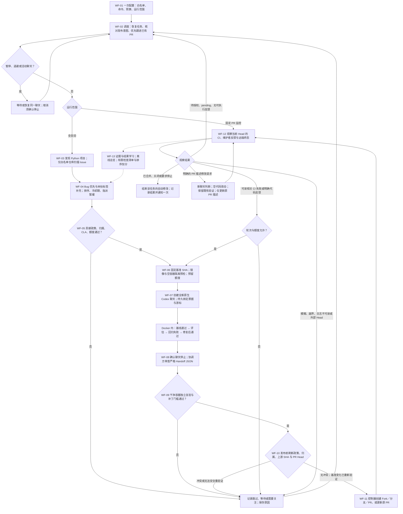
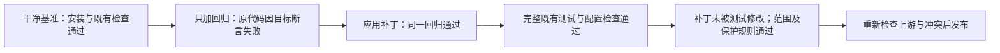
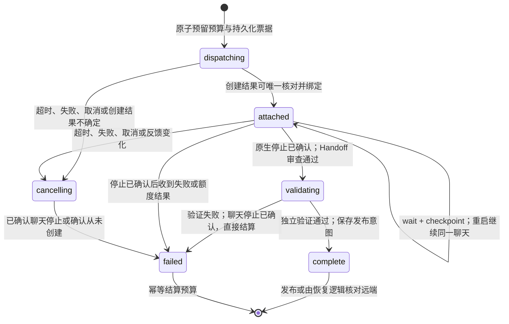

# Autonomous OSS Contributor — Workflow v0.1

基线日期：2026-10-31，Asia/Singapore。状态：当前实现的流程基线。Git 定位：`workflow-v0.1`。软件包版本：`0.3.0a1`，包含该版本之后、建立本基线之前的已实现改动。

目标：操作人员一次配置后，全自动发现、筛选、修复、验证、提交并跟进有效 PR。维护者是否接受和合并单独记录。首次建档将此前迭代整理为一个基线，不补造早期逐次变更时间。

## 总流程

下图的可编辑原始文件为 [workflow.mmd](workflow.mmd)。图中逻辑等待由后续调度周期恢复，不是无限占用模型的循环。任一执行阶段失败、超时或遇到不确定性，都进入控制器的等待、跳过或需要关注状态。

<!-- BEGIN WORKFLOW -->

<!-- END WORKFLOW -->

描述修改仍经过新聊天的票据、绑定、游标、停止确认、Handoff 审查和发布前检查。图中缩写不免除这些步骤。监控模式可以修订既有授权 PR，但不能发现或发布新任务。

## 节点、责任与证据

| 节点 | 控制器/执行者 | 输入与关键判断 | 留存结果 |
| --- | --- | --- | --- |
| WF-01 | 操作人员一次配置；控制器约束范围 | TOML 白名单、真实命令、预算；autopilot 或固定 monitor 身份 | 配置、SQLite scope；不逐 Issue 要求人工操作 |
| WF-02 | App 协调会话 + `Desktop.tick` | 原生 heartbeat；活动票据优先；已验证发布恢复；已有 PR 优先 | job 状态、thread ID、cursor、发布意图、通知 |
| WF-03 | `Engine.discover` + GitHub | 全网发现只存候选；配置内仓库始终扫描 | candidates、唯一 repo/issue task、搜索证据 |
| WF-04 | `Selector` | Bug 优先；每仓库剩余额度补充未标 Bug 标签的 Issue；创建时间、指派和排序信号 | discovery、selection 分数/原因/暂缓/可重试时间 |
| WF-05 | `eligibility` + GitHub | 贡献政策、CLA、指派、认领评论、关联 PR、截断或不确定证据；并发及预算 | 跳过/阻塞原因；真正开工前刷新完整证据 |
| WF-06 | `Desktop.dispatch` + `Environments` | 固定 SHA/仓库命令；本地镜像存在；空容器隔离通过；检查新建或修订额度 | job 中的基准、命令摘要、回归路径、previous_head、期限；环境报告 |
| WF-07 | App 协调会话创建，原生聊天修复 | 先按票据核对历史，避免重复创建；新聊天无 GitHub 写操作；目标代码只在 Docker 执行 | 一个活动票据和聊天；worker 结构化评估及候选补丁 |
| WF-08 | App 协调会话 + `Desktop.finish` | 原生终态已确认；指定路径的严格 JSON；票据、配置和授权一致 | accepted-handoff、诊断、补丁；异常不伪造完成 |
| WF-09 | `Engine.validate` | 独立重新下载基准；原基线、回归红/绿、完整检查；补丁范围与保护规则 | validation-report、实际命令/退出码/输出、文件和行数 |
| WF-10 | `Engine.publish` / GitHub | 再读政策、冲突、最新上游；变更能安全适用时重新验证，否则停止；修订 Head 保持已记录值 | 最新基准及验证记录，或外部修改/冲突原因 |
| WF-11 | 宿主机 GitHub 适配器 | 确定性分支，创建/复用 Fork，普通 PR；修订更新同一 PR；描述遵循模板、关联 Issue 并披露 AI 辅助 | publication intent、PR/Head、已处理反馈 ID；重启核对远端 |
| WF-12 | 观察监听器 + App 协调会话 | 仅当前 Head 的 CI/可执行维护者反馈可触发修订；pending、授权等待、无检查分别记录 | 当前 CI/check/run ID、Review ID、终态、一次性实质通知 |
| WF-13 | `LearningMemory` + `Selector` + dashboard | 远端结果和反馈是证据；检查清单由控制器定义；历史合并仅给有限排序加分 | feedback_memory、pr_outcomes、learning 报告、离线 dashboard |

## 独立质量门槛

worker 自评和测试声明不能代替控制器的实际执行。修订保留原始回归测试；默认最多 5 个文件、200 行增删之和，不能削弱测试或修改 CI、依赖、发布和凭据配置。仅描述修订复用既有验证，不声称运行了新测试。

## 原生聊天生命周期与恢复

这是主要代码修复路径的示意；合规 skip、已确认停止后的失败和描述路径可直接结算。`complete` 是聊天工作结算，不等于 PR 已创建或被接受；任务另有 `validated`、`publishing`、`open`、`merged` 等状态。

创建响应丢失时先查 App 历史，不盲目再开聊天。未确认停止的聊天保留串行执行位和模型预留；清除 paused 不能释放它。原生停止由协调会话据真实工具结果确认，Python 本身不独立证明原生进程终态。发布中断则核对远端分支/PR；不强推、不覆盖外部提交。

## v0.1 默认参数

实际运行以一次性授权的配置与持久范围为准。下表是代码默认值，不把临时额外授权推广为永久额度。

| 项目 | 默认 |
| --- | --- |
| 项目发现 | Python、公开、非归档、非 Fork；≥500 Stars；最近 30 天有推送；每轮最多 50 个仓库 |
| 扫描与调度 | 每仓库最多 10 个 Issue；发现间隔 1 小时；原生 heartbeat 约 10 分钟；可选通知监听默认 60 秒并服从服务端间隔 |
| 筛选 | Bug 优先并补充未标 Bug 标签候选；新 Issue 冷却 24 小时；指派快照暂缓直到刷新；旧任务缺少创建元数据时仍走既有完整资格检查 |
| 排序 | Bug +20；邀请标签 +5；代码块 +15；复现语言 +10；预期/实际 +10；错误信号 +5；设计/功能请求信号 −25；同仓库每个已观察合并 +2，上限 +6 |
| 日额度 | 新加坡日期；最多 3 次新 Issue 尝试、1 个新 PR、120 分钟模型任务；每轮最多 30 分钟 |
| 并发与修订 | 串行；全局最多 3 个开放自动 PR、每仓库 1 个；每 PR 最多 2 轮自动修订 |
| 目标执行环境 | 非 root Docker；2 CPU、4 GiB、128 PIDs；安装只经 PyPI 代理；修复/测试断网；无个人目录、凭据或 Docker Socket 挂载 |
| 环境预检 | 镜像 ID 改变立即失效；成功预检最多复用 1 小时；目标依赖和验收环境每次重新安装 |

这些文本信号是启发式，不证明可复现性或合并概率。候选数量、Stars 和历史合并不能扩大白名单或替代政策、归属与质量判断。

## 分析口径

| 指标 | 口径与用途 |
| --- | --- |
| 发现/筛选 | 分别统计候选仓库、唯一 Issue、暂缓/跳过原因；重复轮询不增加唯一 Issue 数 |
| 实际开工 | 按控制器已预留新任务尝试的唯一 task 统计；修订轮次单列 |
| 验证通过率 | 独立复验通过的新任务数 / 进入独立复验的新任务数；worker 自评不计通过 |
| PR 产出率 | 成功新建 PR 的任务数 / 新任务实际开工数；恢复及重复发布不重复计算 |
| 远端结果 | 合并、未合并关闭、仍开放分别记录；统计 PR cohort、观察截至时间与观察窗口。关闭不等于质量差，开放不算失败 |
| 合并比例 | 对明确 cohort 给出 merged / 全部已提交，以及 merged / 已终结两种分母；样本数与仍开放数必须同时展示，不作为单个任务成功概率 |
| 成本与自动程度 | 控制器结算的模型秒数、实际修订次数、人工介入次数；不把额度预留直接当实际耗时。尚未统一采集的指标标明缺失 |
| 等待和阻塞 | CI 授权等待、依赖失败、基线失败、限流、预算和范围冲突分别统计，避免误归因给模型修复能力 |

本次建立指标口径，尚未新增全套聚合分析器。SQLite/JSONL、job 证据、CI 和 feedback/outcome 记录是后续分析来源；现有 dashboard 是离线快照。

## 已实现与待验证的边界

- 当前主路径是原生 Codex App 聊天与 Python 控制器协作；App 和机器需保持可用。原生聊天仍拥有宿主机工具，Docker-only 是工作约定，不等同于能力移除。
- 不自动评论、回复 Review、合并、批准或请求 CI 授权；不切换认证。模糊或范围外反馈记录需要关注。任务终态后结束修改；停止任务只可继续记录远端终态。
- 反馈检查清单与合并加分已实现；自动改写策略、校准合并概率、依赖缓存、完整环境快照、模型独立第二轮评审均不属于本基线的已实现能力。
- 既有模拟测试和真实 Docker 测试覆盖控制器路径；不能据此宣称所有原生 App 长期无人值守场景或真实远端 CI 修订轮均已完成端到端验证。

基线源码校验见 [manifest.json](manifest.json)；验证与首次归档见 [CHG-20261031-001](../changes/2026-10-31-001-baseline.md)。
